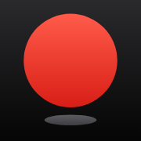
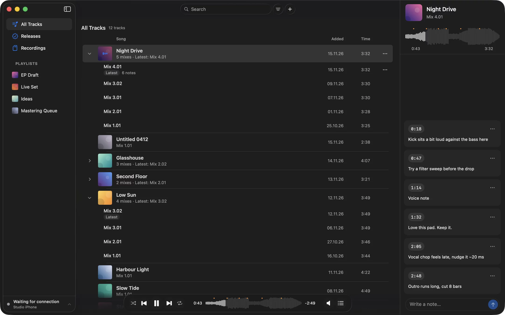
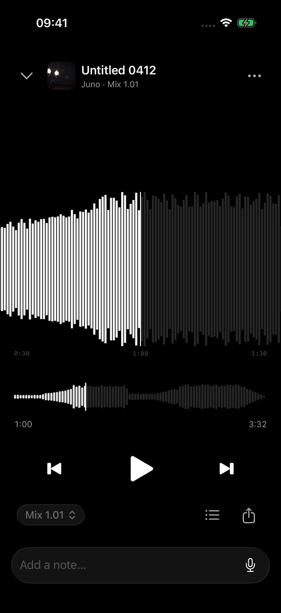

  

<h1 align="center">Bounce</h1>

  A home for your unfinished music. 
  Organize demos, compare mixes, and leave notes while you listen. Mac and iPhone, synced over your own Wi-Fi.

  <a href="https://github.com/merlinkraemer/bounce/releases/latest/download/Bounce.dmg"><b>Download for Mac</b></a>
  &nbsp;·&nbsp;
  <a href="https://apps.apple.com/app/id6835746539"><b>Get it for iPhone</b></a>
  &nbsp;·&nbsp;
  <a href="https://onbounce.app">onbounce.app</a>

  
  &nbsp;
  

## Why Bounce

Bounces pile up in folders, chats and cloud drives. Bounce keeps every version of every track in one library on your Mac and puts it on your iPhone, so you can listen away from the studio and come back with notes.

- **No account.** Nothing to sign up for.
- **No cloud.** Sync runs on your local network only.
- **No storage limit.** Your library is as big as your disks.
- **No subscription.** Free and open source, MIT licensed.

## Features

- **Versions.** Keep every mix of a track, switch between them, A/B and see what still needs work.
- **Notes.** Leave timestamped notes on your phone. Back on the Mac, open them next to your DAW.
- **Sync.** Pair once with a QR code. After that your library syncs whenever both devices are on the same Wi-Fi.
- **Playlists.** Sequence sets and album drafts.
- **Drag and drop.** Drop audio onto the window or the menu bar icon to import. Drag tracks out into Finder or your DAW.
- **Updates.** The Mac app updates itself.

## Install

**Mac** (macOS 26 or later)

- [Download the DMG](https://github.com/merlinkraemer/bounce/releases/latest/download/Bounce.dmg), or
- Homebrew: `brew install --cask merlinkraemer/tap/bounce`

**iPhone** (iOS 18 or later)

- [App Store](https://apps.apple.com/app/id6835746539)

Both devices need to be on the same Wi-Fi network to sync.

## How pairing works

1. Open Bounce on the Mac and on the iPhone.
2. Scan the QR code shown on the Mac with the iPhone, or pick the Mac from the list of nearby devices.
3. Tracks sync over the local network. The pairing is stored in the keychain on both devices.

## Build from source

See [BUILDING.md](BUILDING.md).

## Contributing

Bounce is maintained in spare time. Issues and pull requests are welcome, with no promise of response time. See [CONTRIBUTING.md](CONTRIBUTING.md).

## Privacy and security

Bounce collects no data. See [PRIVACY.md](PRIVACY.md) and [SECURITY.md](SECURITY.md).

## License

[MIT](LICENSE). Apple trademarks and artwork (such as the App Store badge and device frames) are not covered by this license.
